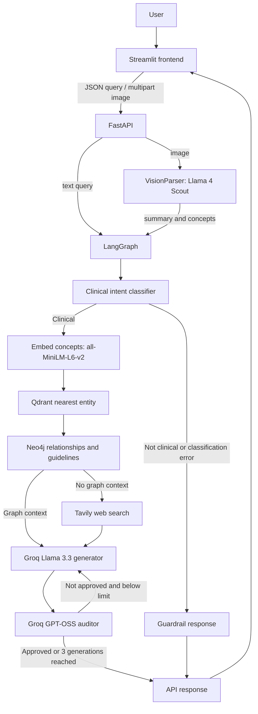

# Healthcare Graph-RAG v2

This repository contains a clinical question answering prototype with a FastAPI backend and Streamlit frontend. A LangGraph workflow classifies a query, retrieves context from a local Neo4j/Qdrant knowledge base or Tavily web search, generates a response with Groq-hosted Llama 3.3, and sends the response through a second model for an audit attempt. The API also accepts clinical report images for vision-based extraction before running the query workflow.

> **Important:** This repository is a prototype. Its model-based classification, retrieval, and audit do not establish clinical correctness or make it suitable for clinical use.

## Architecture



The graph and vision flow are implemented in `core/graph_engine.py` and `core/vision_parser.py`. The diagram describes the code path; it does not imply that the audit guarantees a safe or correct answer.

## Request flow

### Text query

1. The Streamlit app sends a JSON request to `POST /api/v1/clinical-query`.
2. The `extract` node classifies the query and extracts concepts. It also includes the last four chat-history messages in this classification prompt. Classification errors default to rejection.
3. Non-clinical queries return a fixed guardrail response without retrieval or generation.
4. Clinical concepts are embedded with `all-MiniLM-L6-v2`. For each concept, the graph searches the Qdrant `medical_entities` collection for one nearest entity, then uses that entity name for Neo4j relationship queries.
5. If Neo4j yields no context, the graph tries Tavily advanced search for up to three results. The generation prompt receives the current query and retrieved context; it does not include the chat history.
6. The generator response is audited against retrieved context. An unapproved response is regenerated with the prior critique added to the prompt. The graph stops when approved or after three total generations.

### Image report

The UI accepts PNG, JPG, and JPEG files and sends them to `POST /api/v1/analyze-report`. The vision parser sends a base64 data URL to Groq's `meta-llama/llama-4-scout-17b-16e-instruct` model and extracts a clinical flag, concepts, and summary. If considered clinical, the API turns the summary and concepts into a synthetic query and invokes the same graph. Non-clinical images receive a guardrail-shaped response. The uploaded image is written temporarily by the API and removed in a `finally` block after processing.

## Components

| Component | Implementation |
| --- | --- |
| Frontend | Streamlit in `frontend/app.py` |
| API | FastAPI in `api/main.py` |
| Orchestration | LangGraph in `core/graph_engine.py` |
| Local graph retrieval | Neo4j, database name/default routing as provided by the driver |
| Vector lookup | Qdrant collection `medical_entities`; top one result per extracted concept |
| Embeddings | Hugging Face `all-MiniLM-L6-v2` |
| Web fallback | Tavily advanced search, up to three results |
| Generator | Groq `llama-3.3-70b-versatile` |
| Auditor | Groq `openai/gpt-oss-120b` |
| Image extraction | Groq `meta-llama/llama-4-scout-17b-16e-instruct` |
| Seed data | Hard-coded sample conditions and relationships in `ingest_data.py` |

## Repository structure

```text
.
├── api/
│   └── main.py              # FastAPI routes and request/response schemas
├── core/
│   ├── graph_engine.py      # Classification, retrieval, generation, audit graph
│   └── vision_parser.py     # Image-to-clinical-summary extraction
├── eval/
│   └── evaluate_model.py    # Four live API scenarios
├── frontend/
│   └── app.py               # Streamlit chat and image-upload UI
├── ingest_data.py           # Seeds Neo4j and Qdrant with mock clinical data
├── Dockerfile
├── docker-compose.yml
└── requirements.txt
```

## Configuration

Install the Python dependencies from the repository root:

```bash
python -m pip install -r requirements.txt
```

The dependency list is not version-pinned. Create a root-level `.env` file for the external service credentials and Neo4j connection:

```dotenv
GROQ_API_KEY=your_groq_api_key
TAVILY_API_KEY=your_tavily_api_key
NEO4J_URI=bolt://localhost:7687
NEO4J_USERNAME=neo4j
NEO4J_PASSWORD=your_neo4j_password
```

The code connects to Qdrant at `localhost:6333`; that address is hard-coded and is not configurable through an environment variable in the current implementation. Neo4j and Qdrant must be running and reachable, and the Hugging Face embedding model must be available. The repository's Compose file does not define Neo4j or Qdrant services.

## Load the included sample data

From the repository root, run:

```bash
python ingest_data.py
```

The script seeds a small, hard-coded sample dataset covering Hypertension, Type 2 Diabetes, Chronic Kidney Disease, selected treatments, and selected contraindications. **This script deletes all existing Neo4j nodes and deletes/recreates the Qdrant `medical_entities` collection before loading the sample data.** Use it only against disposable or intentionally reset databases.

## Run locally

Start the API in one terminal:

```bash
uvicorn api.main:app --host 0.0.0.0 --port 8000
```

Start the Streamlit UI in another terminal:

```bash
streamlit run frontend/app.py
```

The frontend calls `http://localhost:8000` directly. FastAPI's generated API documentation is available at `http://localhost:8000/docs`.

## API routes

### `GET /health`

Returns a status object:

```json
{"status": "operational", "engine": "LangGraph v2"}
```

### `POST /api/v1/clinical-query`

JSON body:

```json
{
  "query": "What are the guidelines for hypertension?",
  "chat_history": []
}
```

Each `chat_history` item has `role` and `content` strings. The response model contains:

```json
{
  "generation": "Response text",
  "source_type": "Local Graph",
  "is_approved": true,
  "audit_report": "Approved",
  "retry_count": 1
}
```

### `POST /api/v1/analyze-report`

Multipart form upload using the `file` field:

```bash
curl -X POST http://localhost:8000/api/v1/analyze-report \
  -F "file=@./lab-report.png;type=image/png"
```

It returns the same response fields as the clinical-query endpoint. The values above are examples of response shape, not a promise of a particular source or audit result.

## Evaluation script

`eval/evaluate_model.py` submits four predefined requests to a running API at `http://localhost:8000/api/v1/clinical-query`: a standard clinical query, an off-topic query, a contraindication-oriented query, and a context-switch query.

Run it with the API available:

```bash
python eval/evaluate_model.py
```

The script reports whether the returned `source_type` matches its expected string. It does not calculate clinical accuracy, validate answer content, or enforce assertions. The performance percentages in the previous README are not produced by this script, so they are not documented here as measured results.

## Docker configuration

A Dockerfile builds a Python 3.10 image and starts the FastAPI application on port 8000. The Compose file defines backend and frontend containers, but it does not define Neo4j or Qdrant. In addition, the frontend URL is hard-coded as `localhost:8000`; inside the frontend container, that points to the frontend container itself rather than the backend service. Therefore, the checked-in Compose configuration does not provide a complete working multi-container stack as written.

## Behavior and limitations present in code

- Classification and image extraction are model-driven; the code does not perform deterministic clinical validation.
- The audit asks a second model to compare the response to the context. Reaching three generations ends the graph even if the response remains unapproved; the response schema still returns the `is_approved` value.
- When a web search fails, the graph places an error string in retrieved context and continues to generation.
- The local knowledge base is a small mock dataset, not a supplied clinical guideline corpus.
- The Qdrant address and Streamlit API URL are hard-coded to localhost.
- Query errors are returned as HTTP 500 with a generic API detail. Report-upload processing removes the temporary file in a `finally` block, but the filename is used in the temporary path and the API does not define an upload-size limit.
- No automated unit-test suite is present; the evaluation script requires running services and live provider credentials.
